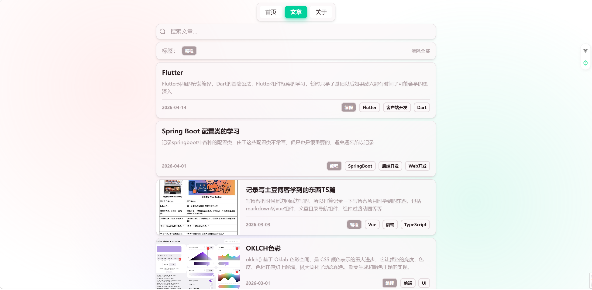
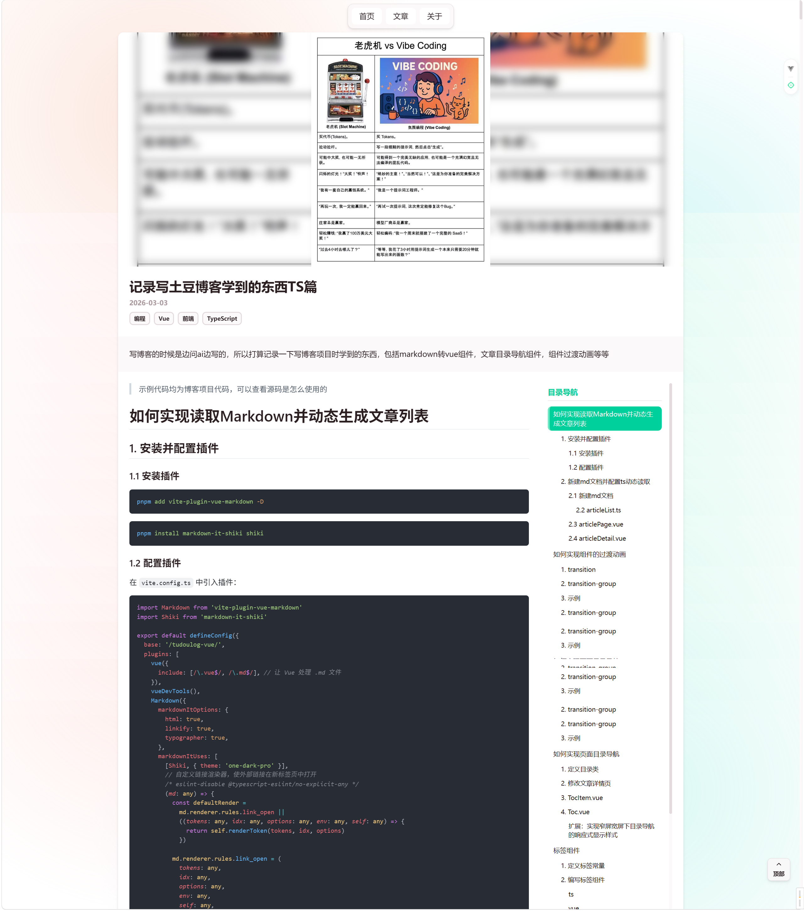

> 由于本人 GitHub 账号被标记，项目已迁移到 Gitee [tudoulog-vue](https://gitee.com/tudouza1/tudoulog-vue)

# tudoulog

一个用 Vue 3 + Vite 构建的 Markdown 博客系统。可以直接用 Markdown 写文章，通过ts识别md生成动态文章列表，所以只需要写md就可以使用博客，支持代码高亮和标签分类以及搜索功能。

## 主要功能

- ✨ Vue 3 + TypeScript
- 📝 Markdown 文章支持
- 🔥 Prism.js 代码高亮
- 🏷️ 文章标签管理
- 📅 按时间排序
- 🎨 响应式设计

## 截图





## 技术栈

- Vue 3.5.28
- Vite 7.3.1
- TypeScript 5.9.3
- Vue Router 5.0.2
- vite-plugin-vue-markdown
- Prism.js + markdown-it-prism

## 快速开始

确保已安装 Node.js (>=20.19.0) 和 pnpm

```bash
# 安装依赖
pnpm install

# 启动开发服务
pnpm dev
```

启动后访问 http://localhost:5173

## 添加文章

在 `src/articles/` 目录下新建 `.md` 文件，文件头部加上这些信息：

```markdown
---
title: '文章标题'
date: '2026-02-22'
tags: ['Vue', 'Markdown', '博客']
excerpt: '文章摘要'
coverImage: '/src/assets/img/coverImage.png'
---
```

## 项目结构

```
src/
├── articles/           # Markdown 文章
├── assets/             # 静态资源
├── components/         # 组件
├── router/             # 路由
├── styles/             # 样式
├── utils/              # 工具函数
├── views/              # 页面
```

## 联系我

QQ：1715593110<br/>
Email：1715593110@qq.com

## License

This project is **dual-licensed**:

- **All source code** (e.g., `.py`, `.js`, `.css`, `.html` files) is licensed under the **MIT License** – see the `LICENSE` file for details.
- **All blog post content** (Markdown files under `content/posts/` or similar directories) is licensed under the **Creative Commons Attribution-NonCommercial 4.0 International (CC BY-NC 4.0)** – see `LICENSE-CC-BY-NC.md` for details.

In short: You can freely use, modify, and distribute the **code** for any purpose (including commercial). For the **written articles**, you may share and adapt them only for **non-commercial purposes**, and you must give appropriate credit to the original author.
