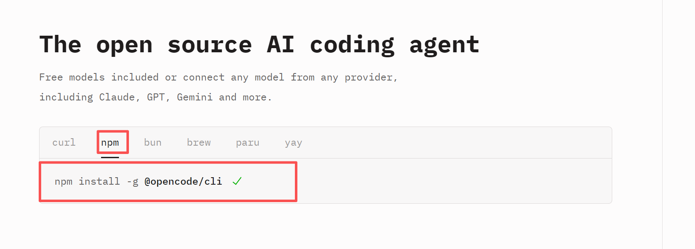
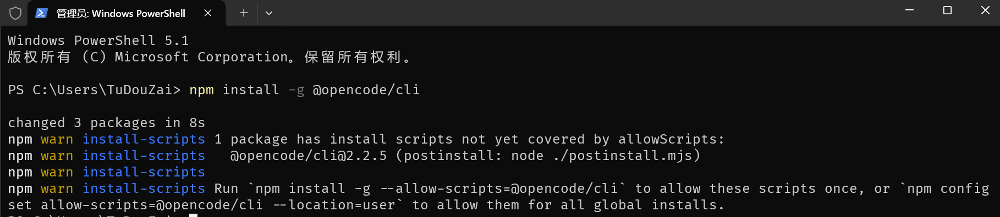
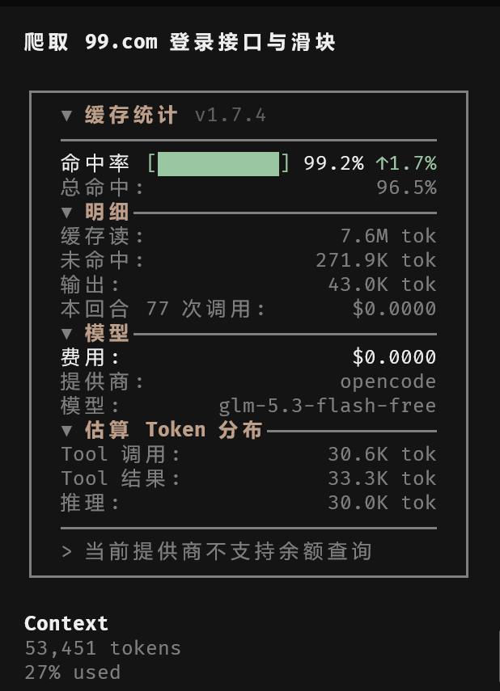
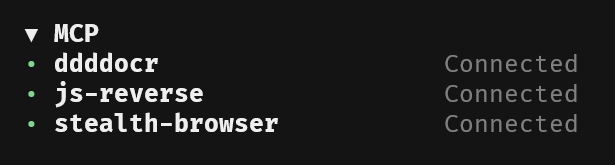

## 前置依赖

1. nodejs

## 安装 opencode

1. 访问opencode官网：[https://opencode.ai/](https://opencode.ai/)，复制npm安装命令



2. 在管理员权限的终端中输入命令




如上安装成功，如果有`error`等可能是没有用管理员终端导致

3. 更新opencode：如果opencode提示可以更新，不要用opencode提供的更新命令，在任务管理器把 `bun.exe` 全部结束任务，彻底关闭opencode，然后再去管理员终端执行安装时的那个命令，就更新好了


## 配置缓存命中查看插件（可选）

1. 在文件资源管理器打开：`C:\Users\用户名\.config\opencode` 
2. 新建文件 `cli.json` 并输入：

```json
{
  "plugins": [
    {
      "package": "opencode-visual-cache@latest",
      "options": {
        "enabled": true
      }
    }
  ],
  "theme": {
    "mode": "system",
    "name": "opencode"
  },
  "animations": true,
  "debug": {
    "devtools": false
  },
  "session": {
    "scrollbar": true,
    "markdown": "rendered"
  },
  "prompt": {
    "image_preview": false
  },
  "attention": {
    "notifications": true
  }
}
```

3. 安装后的效果



## 配置爬虫 MCP

一共安装三个MCP：js-reverse-mcp（js逆向）+Stealth Browser MCP（浏览器操控）+Ddddocr Captcha MCP（图像滑块识别）

1. 在终端中输入 `opencode` 运行 opencode，如果要在某个项目中打开 opencode 写项目，直接在终端的相应项目位置下启动：


2. 选择免费模型(输入 `/models` 随便选一个)或付费模型(输入 `/connect` 输入 `api ley` )
3. 让ai帮你装mcp，对话框输入提示词：`给 opencode 安装：js-reverse-mcp（js逆向）+Stealth Browser MCP（模拟浏览器）+Ddddocr Captcha MCP（图像滑块识别）这三个 mcp 服务，装在d盘并测试` ，中间可能会询问安装问题，允许即可
4. 终端窗口最大化在右侧的mcp显示安装的三个mcp就算安装成功：



这些 MCP 在其他的AI工具也可以安装使用
